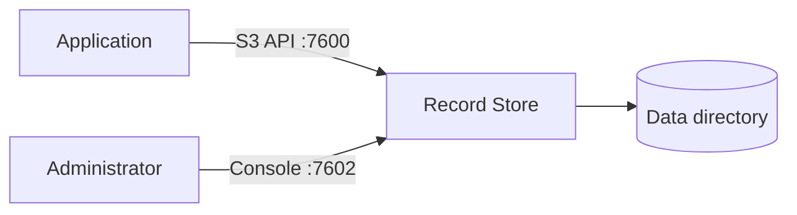

# Overview

Record Store stores files, called *objects*, and serves them over an
S3-compatible HTTP API. If your application works with Amazon S3, it works with
Record Store.

## Use cases

Use Record Store when you want to run your own object storage. Typical uses
include the following:

- Application file storage, such as uploads, exports, generated documents, and
  media.
- Storage that must stay on infrastructure you control.
- A development S3 endpoint that behaves like the one in production.
- Storage for a small team or a single application, without operating a
  distributed system.

Record Store is a single Rust binary with an embedded metadata database. You
don't run an external database, message queue, or object gateway alongside it.

## Listeners and ports

Record Store exposes three listeners. Each listener serves a different audience,
as shown in the following table:

| Port | Listener | Clients |
| --- | --- | --- |
| 7600 | S3 API | Applications, AWS SDKs, embed links |
| 7601 | Management API | The web console, the CLI, automation |
| 7602 | Web console | Administrators, share-link recipients |

In most deployments, only ports 7600 and 7602 are reachable from outside your
network. For more information, see [Ports](../reference/ports.md) and
[Reverse proxy and TLS](../deployment/reverse-proxy.md).

## Deployment architecture

A Record Store deployment is one process that keeps one copy of your data on one
machine:

You don't provision an external database, a coordination service, or a gateway.
You are responsible for the data directory. Put the data directory on durable
storage. To learn what a successful write guarantees, see
[Durability](../concepts/durability.md).

>!!! warning "Redundant storage is not a backup"
    Redundant disks protect your data against hardware failure. They don't
    protect it against an accidental delete, because Record Store writes a
    delete as reliably as any other change. To plan backups, see
    [Backup and restore](../operations/backup-and-restore.md).

## What's next

- To choose an installation method, see [Installation](installation.md).
- To run Record Store and store an object in about five minutes, see the
  [Quick start](quick-start.md).
